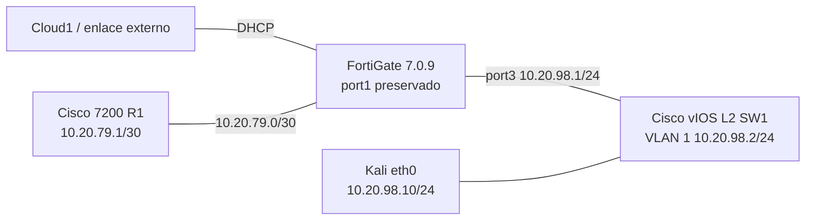
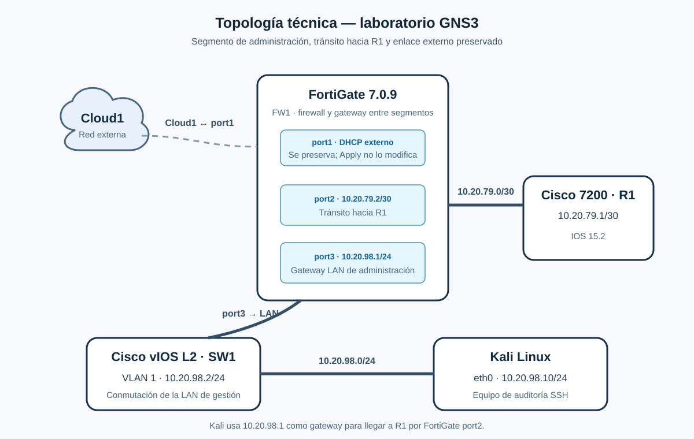

# Auditoría y hardening de red — práctica GNS3

Proyecto académico desarrollado desde Kali Linux para documentar y auditar controles seleccionados en una topología con Cisco 7200, Cisco vIOS L2 y FortiGate 7.0.9.

> El escáner evalúa un subconjunto de controles. No es una certificación ni demuestra cumplimiento CIS integral.

## Estructura completa

| Carpeta/archivo | Qué contiene |
|---|---|
| [`configs/`](configs/README.md) | Fichas de evidencia para R1, SW1 y FW1. Se identifican como parciales; no se fabrican volcados completos. |
| [`scripts/`](scripts/README.md) | Auditor Python, dependencias y uso de `audit`, `plan` y `apply`. |
| [`controles/`](controles/README.md) | Alcance CIS, IDs, referencia de versión, auditoría y Apply por plataforma. |
| [`docs/`](docs/README.md) | Informe técnico de la práctica, topología, uso en Kali, guion y evidencias. |
| [`diagramas/`](diagramas/README.md) | Diagrama técnico vectorial SVG y captura original GNS3. |
| [`imagenes/`](imagenes/README.md) | Capturas enviadas, saneadas y descritas. |
| `requirements.txt` | Dependencia Netmiko. |
| `.gitignore` | Excluye informes, respaldos y archivos sensibles generados. |

## Topología y direccionamiento





Consulta el [informe técnico en PDF, con imágenes](docs/INFORME_TECNICO_PRACTICA.pdf), su [versión Markdown editable](docs/INFORME_TECNICO_PRACTICA.md) y las [fichas de configuración/evidencia](configs/README.md).

## Inicio rápido en Kali

Desde la raíz del repositorio:

```bash
python3 -m venv venv
./venv/bin/python -m pip install -r requirements.txt
```

Escaneo sin cambios:

```bash
./venv/bin/python scripts/auditor.py --mode audit --phase PRE
```

Vista previa de sugerencias, sin cambios:

```bash
./venv/bin/python scripts/auditor.py --mode plan --phase PRE
```

Apply interactivo:

```bash
./venv/bin/python scripts/auditor.py --mode apply
```

Apply vuelve a auditar antes de configurar, crea respaldos privados de las secciones afectadas, presenta el plan y requiere escribir `APPLY`. Después genera POST. No cambia FortiGate `port1` ni guarda automáticamente `startup-config`. Consulta primero [uso en Kali](docs/USO_EN_KALI.md) y [controles CIS](controles/alcance_cis.md).

## Referencias CIS y límites

- Cisco usa CIS IOS Benchmark v2.2, archivado y genérico, como referencia cercana para IOS 15.2/vIOS L2.
- FortiGate usa CIS FortiGate 7.0.x v1.2.0 como referencia cercana a 7.0.9; Fortinet indica que fue probado con 7.0.10.
- Apply solo cubre un subconjunto de reglas reversibles. DNS, NTP, políticas con servicio `ALL` y cambios de servicios por interfaz requieren revisión manual.
- Los respaldos, informes y configuraciones completas no deben publicarse sin saneamiento.

Los IDs exactos y controles automatizados están en [`controles/alcance_cis.md`](controles/alcance_cis.md). El listado de capturas está en [`docs/EVIDENCIAS.md`](docs/EVIDENCIAS.md).

## Fuentes

- [CIS Cisco IOS Benchmark v2.2](https://www.cisecurity.org/-/jssmedia/Project/cisecurity/cisecurity/data/media/files/uploads/2017/04/CIS_Cisco_IOS_Benchmark_v22.pdf)
- [CIS Fortinet Benchmarks](https://www.cisecurity.org/benchmark/fortinet)
- [Nota de Fortinet: ediciones FortiGate 7.0.x y versión probada](https://community.fortinet.com/fortigate-3/technical-tip-cis-benchmark-compliance-for-fortigate-200849)
- [CLI FortiOS 7.0.9: configuración global](https://docs.fortinet.com/document/fortigate/7.0.9/cli-reference/1620/config-system-global)
- [FortiOS 7.0.9: NTP](https://docs.fortinet.com/document/fortigate/7.0.9/administration-guide/336196)
