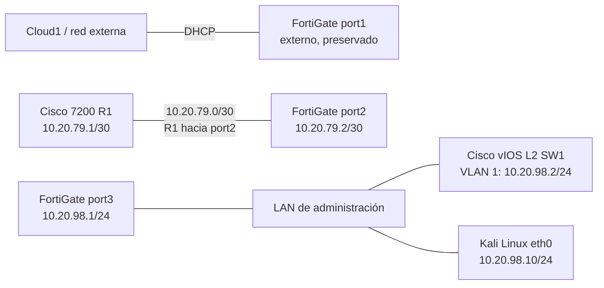
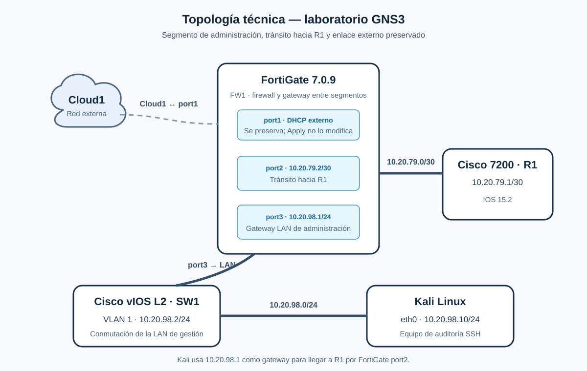
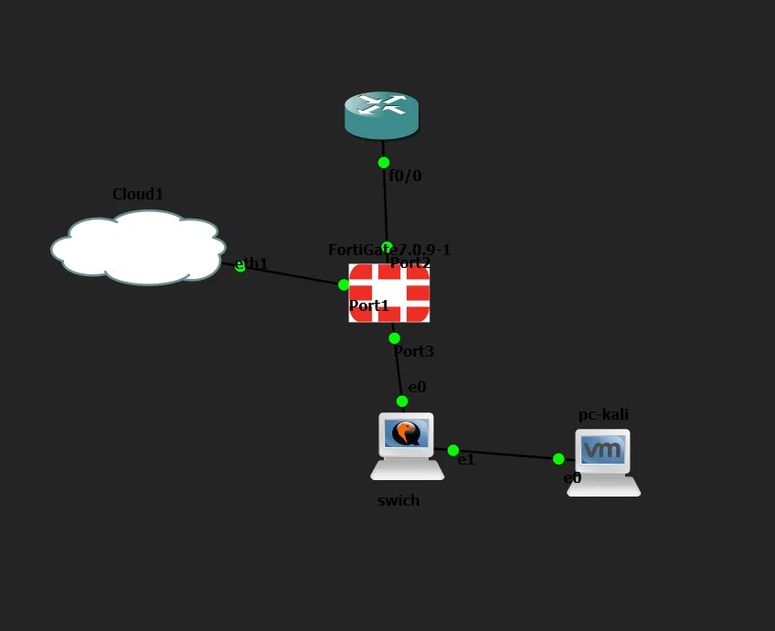
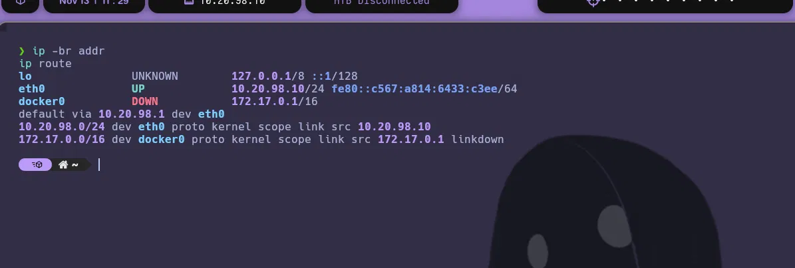
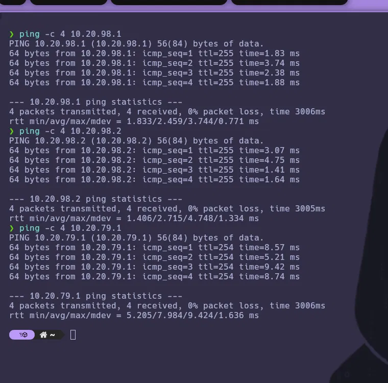
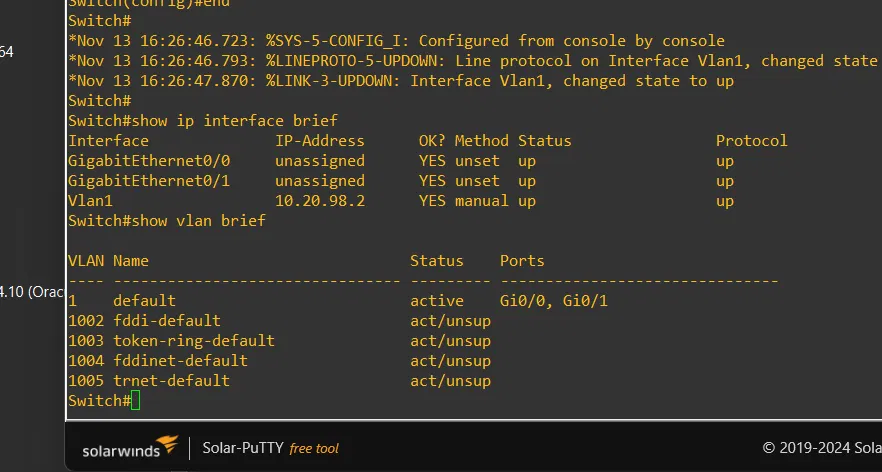

# Documentación técnica de la topología GNS3

## Propósito

La topología permite probar conectividad desde Kali, administrar R1/SW1/FW1 por SSH y auditar controles de configuración desde un único equipo. FortiGate conecta la red de tránsito del router con la LAN de administración y mantiene port1 para su enlace externo existente.

## Diagrama lógico

## Inventario y direccionamiento observado

| Equipo/interfaz | Dirección | Función |
|---|---:|---|
| Kali `eth0` | `10.20.98.10/24` | Estación de auditoría en la LAN de administración. |
| SW1 `Vlan1` | `10.20.98.2/24` | Gestión del switch. Puertos de acceso visibles conectan los nodos del segmento LAN. |
| FortiGate `port3` | `10.20.98.1/24` | Gateway de la LAN de administración. |
| FortiGate `port2` | `10.20.79.2/30` | Enlace de tránsito al router R1. |
| R1 | `10.20.79.1/30` | Interfaz del router hacia FortiGate. |
| FortiGate `port1` | DHCP externo | Enlace a Cloud1/red externa. Se preserva; no se incluye su IP DHCP dinámica. |

Versiones declaradas: Cisco IOS 15.2 para R1 y SW1; FortiOS 7.0.9 para FW1. Una captura del informe identificó R1 como IOS `15.2(4)S6`; el proyecto usa como alcance de auditoría IOS 15.2 sin atribuir esa subversión a SW1.

## Flujo de tráfico de auditoría

Kali llega a FW1 port3 en la LAN `10.20.98.0/24`. Para alcanzar R1 `10.20.79.1`, utiliza `10.20.98.1` como gateway; FortiGate enruta el tránsito a su port2 `10.20.79.2/30`. SW1 proporciona conectividad de capa 2 entre Kali y port3; su dirección `10.20.98.2` permite administrar el switch.

La conectividad ICMP observada fue exitosa desde Kali hacia `10.20.98.1`, `10.20.98.2` y `10.20.79.1` (4 de 4 respuestas para cada destino en la captura). El auditor usa TCP/22 y SSH para leer comandos de estado y configuración.

## Capturas y límites

La captura original de topología tiene etiquetas superpuestas; el diagrama vectorial aclara las conexiones. No se publica la dirección dinámica de port1. Las capturas FortiGate están recortadas para mostrar port2/port3 sin divulgar los datos de port1.
